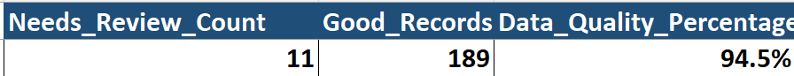
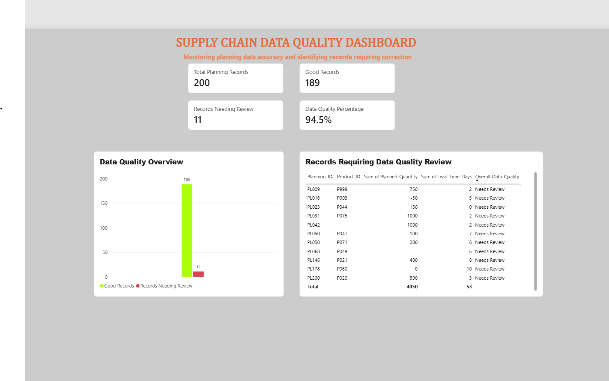

# Supply Chain Data Quality Analysis Using Excel

## Project Overview
This is a self-directed portfolio project using a fictional supply-chain planning dataset to identify data-quality issues and improve data reliability.

The project simulates data validation tasks relevant to supply-chain planning, master data management, and reporting.

## Tools Used
- Microsoft Excel
- Excel formulas: `IF`, `COUNTIF`, `TRIM`, `ISNUMBER`, and `DATEVALUE`
- Filtering and data-quality summaries

## Dataset
The workbook contains:
- **Product Master:** 100 product records
- **Planning Data:** 200 planning records

The dataset is fictional and created for learning and portfolio demonstration. It is not company data.

## Data Quality Checks
The analysis checks for:
- Duplicate planning IDs
- Missing or invalid planned quantities
- Invalid lead times
- Missing or invalid minimum order quantities
- Missing or unmatched product IDs
- Extra spaces in product IDs
- Invalid planning dates

## Results
The initial analysis identified:
- 11 planning rows requiring review
- 189 planning rows marked as good
- 94.5% of planning rows marked as good

The review count includes both occurrences of a duplicated planning ID. These results reflect the checks implemented in this practice dataset.

## Key Learning Outcomes
- Applied Excel formulas to validate data
- Identified data-quality issues in planning records
- Checked product IDs against a master data list
- Created an overall data-quality status and summary
- Practised a workflow relevant to supply-chain data validation

## Disclaimer
This is an independent learning project based on fictional data. It is not affiliated with or based on confidential data from any other company.

## Project Results

## Power BI Dashboard

### Supply Chain Data Quality Dashboard

**Objective:** Monitor supply chain planning data quality and identify records that require correction.

**Tools Used:** Power BI Desktop, Power Query, DAX, Excel

**Key Results:**
- Analyzed 200 planning records.
- Identified 189 records classified as good.
- Flagged 11 records requiring review.
- Calculated an overall data quality rate of 94.5%.

**Dashboard Features:**
- KPI cards for key data quality indicators.
- Chart comparing good records with records needing review.
- Filtered table displaying records that require attention.
- Data quality measures created using DAX.

**Project Outcome:** Created a visual report to help users monitor planning data quality and identify records needing further investigation.

